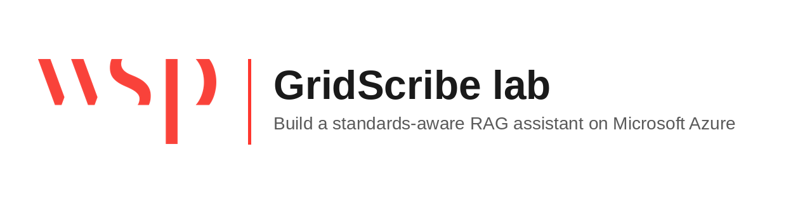
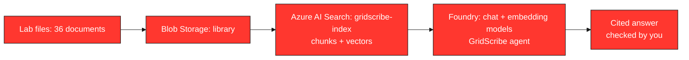

<picture>
  <source media="(prefers-color-scheme: dark)" srcset="assets/brand/banners/readme-banner-dark.png">
  
</picture>

    

# GridScribe

Welcome to **Beyond the data: how AI really works inside an engineering firm**, University of Cambridge Engineering Insight Day at WSP Cambridge, Wednesday 25 November 2026, 13:50–14:35.  No Azure experience or local software installs needed.

## Your mission

WSP is drafting an Electrical Design Basis Report for the **fictional Fen Edge Energy Hub**, a 30 MW solar farm with four BESS containers and six rapid-charging bays in Cambridgeshire, for **fictional Fenland Power Co-operative**. Build GridScribe to search a mixed library of 36 documents, then draft a cited compliance table. Some sources are old, one is a draft, and an important answer is missing. Your job is to check the evidence, not just admire the answer.

## What is RAG?

Retrieval-Augmented Generation (RAG) retrieves useful passages before asking a model to answer. Those passages give the model context without training a new model. Citations help you check the answer, but do not prove that it is correct.

**Applied AI engineers build WITH models rather than training new ones.**

**RAG hands the model the right pages, but engineers still check the edition, the clause and the number.**

The embedding deployment is called during indexing and query vectorisation; the chat deployment writes the answer. Keep **every resource in one resource group**, including anything the portals create automatically.

## Before you start

- Have a personal Microsoft or GitHub account, a phone and your university email ready. **Never use your work account.**
- You create your Azure account **in the room**, not in advance. Try Azure for Students first; have a non-prepaid, non-virtual debit/credit card available only if you choose the free-account alternative.
- Use [Azure portal](https://portal.azure.com) and [Microsoft Foundry](https://ai.azure.com) in two tabs, signed in with the same account. Downloading/unzipping the library is not a software install.
- About nine students: work alone or pair up. Never share passwords or card details.

> [!IMPORTANT]
> **Stay on the free tiers.** Everything runs on the AI Search **Free** tier with key-based connections, plus pay-per-use models that cost pennies for this lab. Never upgrade to pay-as-you-go to get past an error: pair up with a neighbour instead. Delete the resource group at the end ([Step 9](docs/09-clean-up.md)).

> [!NOTE]
> TODO (facilitator): verify in dry run — run the whole route once on a fresh free account and once on an Azure for Students subscription (36 files indexed, cited answers, under 25 minutes), and confirm both can create a Free search service and deploy the two models in the recommended region.

**How GridScribe is grounded:** a **Foundry agent with the Azure AI Search tool**, reading `gridscribe-index` directly and citing the file each fact came from; see [Step 6](docs/06-connect-and-ask-gridscribe.md). Alternatives (Foundry IQ, or the Chat playground's "Add your data") are listed in [troubleshooting](docs/troubleshooting.md) for after the session.
## Settings

Replace angle-bracket placeholders; do not type the brackets. Use lowercase initials, for example `ha`, and your own four digits.

| Setting | Value |
| --- | --- |
| Resource group | `rg-gridscribe-<initials>` |
| Storage account | `stgrid<initials><4 digits>`; Standard, general-purpose v2, LRS, Hot |
| Blob container | `library`; private |
| Search service | `srch-gridscribe-<initials>-<4 digits>`; **Free** (Basic only as a facilitator-approved fallback; see [Step 3](docs/03-create-ai-search.md)) |
| Search index | `gridscribe-index` |
| Foundry resource | `ai-gridscribe-<initials>-<4 digits>`; Standard S0, consumption billed |
| Foundry project | `gridscribe-<initials>` |
| `<CHAT_MODEL>` | Candidate default **gpt-5.4-mini**; fallbacks **gpt-5.4-nano**, then **gpt-5.1** (larger/costlier); only with non-zero quota and Azure AI Search tool support |
| Chat deployment name | `gridscribe-chat` (deploy the selected model under this name) |
| Embedding model / deployment | `text-embedding-3-small` / `text-embedding-3-small`; 1,536 dimensions |
| Candidate region | **Sweden Central** (`swedencentral`) |
| Region fallbacks | **East US 2** (`eastus2`), then **UK South** (`uksouth`); check subscription policy and both models before creating resources |

These are candidates, not promises of model availability on a free subscription. A Global Standard deployment may process requests outside the resource region: use **fictional data only**. See [model and region checks](docs/04-foundry-and-models.md).

## Your 25-minute build

**Start creating AI Search early; it takes a few minutes.** Launch [Step 3](docs/03-create-ai-search.md) as soon as the resource group exists, then return to storage.

| Timed stage | Task | Budget | Guide |
| --- | --- | --- | --- |
| 0 | Free account + resource group | 5 min | [Step 0](docs/00-get-your-azure-account.md) |
| 1 | Storage + upload | 4 min | [Step 2](docs/02-storage-and-upload.md) |
| 2 | AI Search | 3 min | [Step 3](docs/03-create-ai-search.md) |
| 3 | Foundry + models | 4 min | [Step 4](docs/04-foundry-and-models.md) |
| 4 | Index the library | 4 min | [Step 5](docs/05-index-the-library.md) |
| 5 | Ask and test | 5 min | [Step 6](docs/06-connect-and-ask-gridscribe.md), [Step 7](docs/07-test-and-evaluate.md) |

The diagram/explainer is [Step 1: what is RAG?](docs/01-what-is-rag.md), read during the introduction. Timed stage numbers group tasks; document step numbers are the navigation order. Budgets include portal waiting where possible, but are **targets to validate**, not measured results.

## Check the result

1. Use the [test questions](prompts/test-questions.md) without opening their hidden answers.
2. Ask for the eight-row [Section 4 report template](templates/design-basis-report-section4.md).
3. Open citations and inspect the actual source: document, edition, status, clause and number.
4. Score it using the [student checklist](evaluation/student-checklist.md).

## Cost and safety

> [!IMPORTANT]
> Free credit is **not** the same as every service being free. Storage, embeddings and chat use credit. Basic Search costs money while provisioned, even when idle; if Free is unavailable, use Basic only after checking the displayed price and agreeing with the facilitator, then delete it straight after the session. A Free service cannot simply be scaled up: create a separate Basic service in the same group and use its endpoint.

> [!WARNING]
> [Delete the resource group](docs/09-clean-up.md) before leaving. A budget sends alerts; it does not stop spend. Never paste secrets into chat, screenshots, issues or commits. Neither sign-up offer charges a card unless you explicitly move to pay-as-you-go.

## Everything else

- [Optional: RAG in Cloud Shell](docs/08-optional-rag-in-code.md) — not part of the timed build.
- [Troubleshooting](docs/troubleshooting.md) · [Screenshot capture list](docs/images/README.md).
- [Library catalogue](data/CATALOGUE.md) — **do not upload** this or the answer key.
- [GridScribe instructions](prompts/gridscribe-instructions.md).
- Facilitator: [run sheet](facilitator/run-sheet.md) · [answer key](facilitator/answer-key.md) · [solution walkthrough](facilitator/solution-walkthrough.md) · [backup plan and dry-run TODO register](facilitator/backup-plan.md).
- [Brand guidance](assets/brand/BRAND.md) · [licence](LICENSE) · [raise a help issue](.github/ISSUE_TEMPLATE/i-am-stuck.md).

## Fictional data

EESB (Eastern Energy Standards Board), every EESB standard, all technical notes, projects and clients in this lab are invented. Nothing here is engineering guidance or a real WSP deliverable. The library deliberately mixes current, superseded and draft material. Following the agreed question-only interpretation, three project documents mention the unresolved inverter-noise question; **none provides a noise limit or acoustic guidance**.

  
  
Beyond the data: how AI really works inside an engineering firm

  
Built by WSP's AI Accelerator team for the University of Cambridge Insight Day 2026

