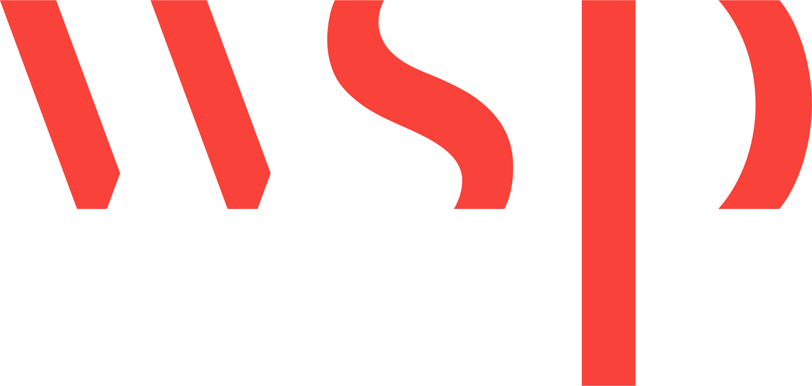

[Home](../README.md) › Step 0

# Step 0 — Get your Azure account

**About 5 minutes, in the session.** You do not need an account beforehand. Use a personal Microsoft or GitHub account, never a work account. Keep identity, university-email and card checks private; the facilitator does not need to see them.

## Which route?

| Route | What you need | Credit |
| --- | --- | --- |
| [Azure for Students](https://azure.microsoft.com/free/students) | No card; university email; full-time student aged 18+ at an eligible institution | USD 100 for 12 months; while activations last |
| [Azure free account](https://azure.microsoft.com/free) | Phone/text verification and eligible debit/credit card; no prepaid or virtual cards | USD 200 for the first 30 days; new eligible customers |

Try **Azure for Students first** if you have a university email. If verification stalls for more than **2 minutes**, try the free-account route if eligible and comfortable using a card, or pair up. Do not spend the build waiting for account approval.

## Route A: Azure for Students

1. Open [Azure for Students](https://azure.microsoft.com/free/students) and select **Start free** (the offer card may say **Sign up**).
2. Sign in with, or create, your **personal Microsoft account**. Use **GitHub** if the sign-in page offers it; otherwise use a personal Microsoft account. Your university email verifies eligibility; it need not be your sign-in identity.
3. Complete **About you** and any phone/text identity check requested. Verify your academic status using your university email and the verification message or institution sign-in shown. No card is required.
4. Read and accept the agreement, then complete sign-up. Select **Azure for Students**, not the more limited Students Starter offer.
5. Open [portal.azure.com](https://portal.azure.com) when activation finishes.

## Route B: Azure free account

1. Open [Azure free account](https://azure.microsoft.com/free) and choose **Start free** / **Try Azure for free**, not the pay-as-you-go sign-up.
2. Sign in with, or create, a **personal Microsoft or GitHub account**.
3. Fill in **About you** and complete identity verification using the text-message code. Enter your own eligible debit/credit card for the card check. A small temporary authorisation hold (often USD 1 or equivalent) is reversed; this is not a lab charge.
4. Read and accept the agreement, then select **Sign up**. Do not choose an upgrade to pay-as-you-go.
5. Continue to [portal.azure.com](https://portal.azure.com).

> [!NOTE]
> TODO (facilitator): verify in dry run — time both sign-up routes, including GitHub availability, the order and labels of About you / phone / academic or card checks, and consent screens. Official offer pages confirm eligibility and credit, not a fixed sequence of every live identity screen. Do not collect students' verification details.

## Set up your workspace

1. Open [Azure portal](https://portal.azure.com) and [Foundry](https://ai.azure.com) with the **same personal account**. Keep the same directory and subscription selected.
2. In Azure portal search, enter **Subscriptions**. Confirm the subscription is **Active**: usually `Azure subscription 1` for the free account, or `Azure for Students`. Names can vary.
3. Search **Resource groups** › **Create**. Select that subscription, name `rg-gridscribe-<initials>`, region **Sweden Central**. Select **Review + create** › **Create**. If the region is blocked, ask the facilitator before using **East US 2** or **UK South**.
4. Start [AI Search creation](03-create-ai-search.md) now, then come back to storage while it deploys.
5. On this repository's GitHub home page, select **Code** › **Download ZIP**. Unzip it using your computer's built-in file manager. Find `data/library/` with its three subfolders. Do not upload the ZIP itself.

> [!IMPORTANT]
> **Your money is safe while the offer's spending protection stays in place.** Neither route charges a card unless you choose to upgrade to pay-as-you-go. The intended lab uses a small part of the credit, but pricing and service access vary. When free-account credit or its 30 days run out, services are disabled unless you upgrade. Student credit lasts 12 months; if exhausted, services are disabled unless you upgrade, and eligible students may renew annually. Delete the resource group at the end anyway.

**Expected result:** Azure home page, an **Active** subscription and an empty resource group (or only your just-started Search deployment).

**If it fails:** card declined/prepaid/virtual → use an eligible card or pair; text missing → check the number and wait before retrying; verification hangs → allow required third-party cookies or try another browser; university email rejected → try the free account; free offer already used → pair with a neighbour. Never upgrade just for this lab. See [troubleshooting](troubleshooting.md).

Sources checked 13 November 2026: [free-account offer and FAQ](https://azure.microsoft.com/pricing/purchase-options/azure-account), [student offer](https://azure.microsoft.com/free/students), [student eligibility](https://learn.microsoft.com/azure/education-hub/about-azure-for-students), [student offer terms](https://azure.microsoft.com/pricing/offers/ms-azr-0170p).

---
[← Previous](../README.md) · [Home](../README.md) · [Next →](01-what-is-rag.md)

WSP AI Accelerator · UoC Insight Day 2026
