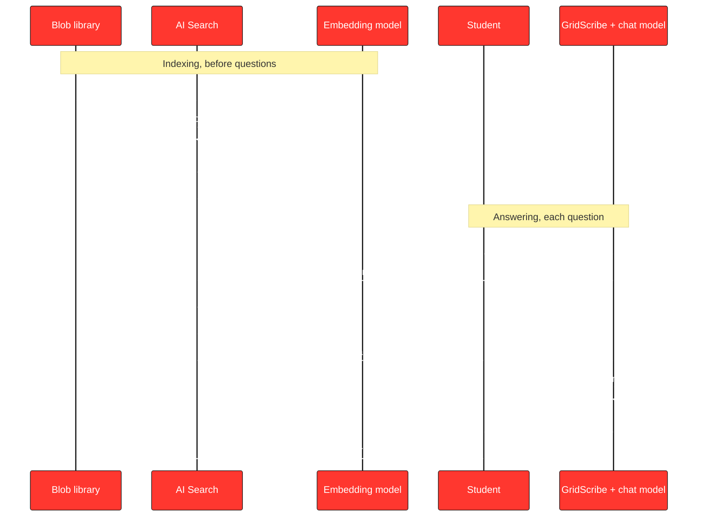

[Home](../README.md) › Step 1

# Step 1 — What is RAG?

**Two-minute explainer during the introduction; no extra build time.**

Imagine an engineer with a very fluent assistant and a document librarian. The librarian finds relevant pages; the assistant writes an answer using them. You still decide whether the right edition and clause were used.

## Two journeys

**Indexing:** store the files → split them into chunks → embed each chunk → put text, source names and vectors in an index. This happens before you ask questions.

**Answering:** ask a question → retrieve relevant chunks → augment the model's prompt with those chunks → generate an answer with citations. The model's trained weights do not change.

## Why not just ask the model?

It has not seen this fictional project library. Fluent answers can still invent values, overlook amendments or confuse a historic note with a current requirement. Retrieval gives it evidence, not a guarantee.

## Why not train a new model?

Training would need data, time, compute and evaluation. It would not give you a simple way to swap an old standard for a new edition tomorrow. RAG updates the searchable library instead.

**Frontier AI engineers** develop and train new foundation models. **Applied AI engineers build WITH models rather than training new ones**, connecting them to data, tools and checks.

## Tiny glossary

| Word | Meaning here |
| --- | --- |
| Chunk | A short passage cut from a document, sometimes overlapping the next passage |
| Embedding | A model's numerical representation of text |
| Vector | The list of numbers that stores that representation |
| Index | A searchable store of text, vectors and metadata |
| Hybrid search | Keyword and vector search combined |
| Grounding | Basing an answer on supplied evidence |
| Citation | A pointer to evidence; you must check that it supports the claim |
| Hallucination | Plausible output that is unsupported or wrong |

**RAG hands the model the right pages, but engineers still check the edition, the clause and the number.**

---
[← Previous](00-get-your-azure-account.md) · [Home](../README.md) · [Next →](02-storage-and-upload.md)

WSP AI Accelerator · UoC Insight Day 2026
