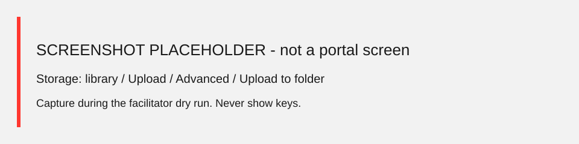

[Home](../README.md) › Step 2

# Step 2 — Store the library

**4 minutes.** First make sure [AI Search is deploying](03-create-ai-search.md).

## 1. Create a storage account

In [Azure portal](https://portal.azure.com), search **Storage accounts** › **Create**:

| Field | Value |
| --- | --- |
| Subscription | Your Active workshop subscription |
| Resource group | `rg-gridscribe-<initials>` |
| Account name | `stgrid<initials><4 digits>`; lowercase letters and digits only |
| Region | The agreed region, normally Sweden Central |
| Performance | Standard |
| Account kind | StorageV2 / general-purpose v2 |
| Redundancy | Locally-redundant storage (LRS) |
| Access tier | Hot |

Keep hierarchical namespace off. Use public network access for this **fictional-only** lab, but keep anonymous blob access disabled. Avoid premium storage, geo-redundancy and optional paid extras. Select **Review + create** › **Create**.

## 2. Create the private container

Open the account › **Data storage** › **Containers** › **+ Container**. Name it `library`, leave **Private (no anonymous access)** selected, then **Create**.

## 3. Upload in three batches

Open `library` › **Upload**. Use the file picker to select **all files inside one local subfolder**, then expand **Advanced** and set **Upload to folder**. This documented field creates virtual folders; you do not need a separate directory-upload feature.

| Local files selected | Upload to folder | Count |
| --- | --- | --- |
| Everything inside `data/library/standards/` | `standards` | 19 |
| Everything inside `data/library/wsp-publications/` | `wsp-publications` | 10 |
| Everything inside `data/library/project/` | `project` | 7 |

Select **Upload** for each batch, wait for completion and check all **36 files** are present. Do not upload `data/CATALOGUE.md`, prompts, evaluation material or facilitator answers.

> [!TIP]
> Short of time? Leave **Upload to folder** blank for each of the three batches. A flat upload also works: every filename is unique. Do not upload both flat and folder copies, which would duplicate the evidence.

> [!NOTE]
> TODO (facilitator): verify in dry run — replace the storage placeholder with a screenshot of the current Upload pane, including multi-select and Advanced › Upload to folder. Confirm the three-batch upload takes under four minutes with account creation.

**Expected result:** one private `library` container holding 19 + 10 + 7 Markdown blobs. [Markdown is supported](https://learn.microsoft.com/azure/search/search-how-to-index-azure-blob-storage#supported-document-formats); no conversion is needed.

**If it fails:** name taken → change the four digits; upload forbidden → check the subscription and your storage access; empty folder → select its files, not the folder icon. See [troubleshooting](troubleshooting.md).

Official steps: [create storage](https://learn.microsoft.com/azure/storage/common/storage-account-create?tabs=azure-portal), [upload with the portal](https://learn.microsoft.com/azure/storage/blobs/storage-quickstart-blobs-portal).

---
[← Previous](01-what-is-rag.md) · [Home](../README.md) · [Next →](03-create-ai-search.md)

WSP AI Accelerator · UoC Insight Day 2026
