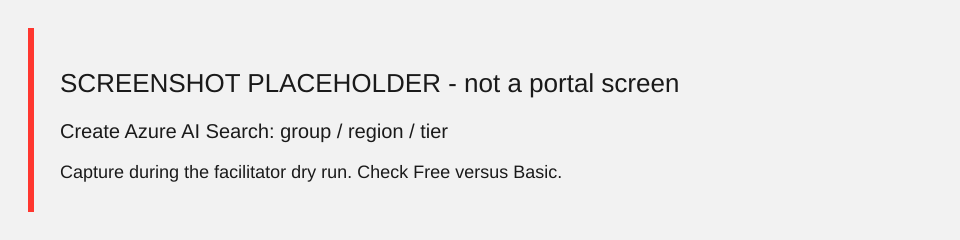

[Home](../README.md) › Step 3

# Step 3 — Create Azure AI Search

**3 minutes of setup; deployment may take longer. Start this immediately after Step 0**, then do storage while it runs.

## 1. Create the service

In [Azure portal](https://portal.azure.com), select **Create a resource**, search **Azure AI Search**, then **Create**.

| Field | Value |
| --- | --- |
| Subscription | Your workshop subscription |
| Resource group | `rg-gridscribe-<initials>` |
| Service name | `srch-gridscribe-<initials>-<4 digits>` |
| Location | Agreed region, normally Sweden Central |
| Pricing tier | Select **Change Pricing Tier** › **Free** › **Select** |
| Compute | Standard, not confidential compute |
| Networking | Public endpoint for fictional lab data; no private endpoint |

Select **Review + create** › **Create**. Keep the deployment tab open.

> [!IMPORTANT]
> There is **one Free search service per subscription**, not one per region. If unavailable, or if the wizard needs managed identity, use **Basic** only with the facilitator's agreement after checking the displayed price (at the time of writing, roughly USD 75 a month, charged by the hour against your credit — about 10 cents an hour). Basic bills every hour it exists, even idle: forgetting it would use up most of a USD 100 student credit in about six weeks, so delete it straight after the session. Select **one replica and one partition**; do not add capacity. A Free service cannot be scaled to Basic: create a new Basic service in the same group instead. Do not delete someone else's existing service.

## 2. Nothing else to set on Free

The Free tier signs in to Storage and to your embedding model with **keys**, which the import wizard handles for you in [Step 5](05-index-the-library.md). There is no identity or role set-up to do here.

Only if you were told to use **Basic**: open Search › **Settings** › **Identity**, set **System assigned** to **On** and **Save**. Step 5 lists the roles to add.

> [!NOTE]
> TODO (facilitator): verify in dry run — that both a fresh Azure free account and an Azure for Students subscription can create a Free search service in the agreed region. If students cannot, announce the Basic fallback (and its cost) or pairs at the start of the build.

## Free limits that matter

| Limit | Free service |
| --- | --- |
| Indexes / indexers / data sources / skillsets | 3 of each |
| Total index storage | 50 MB (source file size is not index size) |
| Vector index memory | 50 MB |
| Maximum source blob | 16 MB; our files are each below 8 KB |
| Indexing load per invocation | 10,000 documents |
| Runtime | Blob baseline 3 minutes; limits table also lists 3–10 minutes for skillset runs |
| Manual invocation interval | At least 180 seconds |
| Foundry Tools free enrichment allowance | 20 documents per indexer per day **if those billable enrichment skills are used** |

The 36 source files are far below the document/size caps, but **a single successful run is not guaranteed**: embedding throttles and runtime limits still apply. Text Split is free; Azure OpenAI embeddings are separately charged to the model resource. Do not add OCR, image or language enrichment: the general 20-document allowance is not a promise of 36 free enriched documents. See [Step 5 monitoring](05-index-the-library.md).

Semantic ranker's current **free billing plan is available across pricing tiers**, subject to regional support and its monthly allowance; it is different from the Search service's Free tier. For a predictable lab, leave semantic ranking **off** and use ordinary hybrid search. Never opt into paid semantic billing for this workshop.

**Expected result:** Search deployment **Succeeded**, the correct tier and region, and its Overview URL ending `.search.windows.net`.

**If it fails:** check Free already used, regional capacity or subscription policy; agree Basic or pair up. Do not spend the build requesting quota. See [troubleshooting](troubleshooting.md).

Sources checked 13 November 2026: [create a service](https://learn.microsoft.com/azure/search/search-create-service-portal), [limits](https://learn.microsoft.com/azure/search/search-limits-quotas-capacity), [semantic billing plans](https://learn.microsoft.com/azure/search/semantic-how-to-enable-disable).

---
[← Previous](02-storage-and-upload.md) · [Home](../README.md) · [Next →](04-foundry-and-models.md)

WSP AI Accelerator · UoC Insight Day 2026
