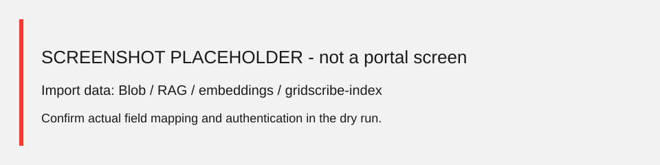

[Home](../README.md) › Step 5

# Step 5 — Index the library

**4 minutes target; indexing may run longer.** Storage contains 36 blobs and the embedding deployment must be ready.

- **Chunking** cuts each document into overlapping passages.
- **Embedding** turns each passage into numbers representing its meaning.
- **Indexing** stores the passages, source metadata and vectors so they can be retrieved.

## 1. Pick your route (30 seconds)

| Your Search tier | How the wizard signs in | What you set |
| --- | --- | --- |
| **Free** (primary) | Keys, handled by the portal | Leave every **managed identity** box **unticked**; embedding kind **Azure OpenAI**, authentication **API key** |
| **Basic** (fallback only) | Search's managed identity | Turn on Search › **Settings** › **Identity** › **System assigned**, assign the roles below, then tick the managed identity boxes |

The Free tier has no managed identity, so it always uses the key route. The portal fetches the storage connection string and model key for you when you pick the resources from the drop-downs; you never copy a key by hand.

<details>
<summary>Basic fallback only: role assignments</summary>

In Azure portal › target resource › **Access control (IAM)** › **Add role assignment**, assignee type **Managed identity**:

| Target resource | Assignee | Role |
| --- | --- | --- |
| Storage account | Search service identity | Storage Blob Data Reader |
| Foundry resource `ai-gridscribe-<initials>-<4 digits>` | Search service identity | Cognitive Services OpenAI User |
| Search service | Your own user | Search Service Contributor; Search Index Data Contributor; Search Index Data Reader |

Allow a few minutes for roles to take effect.
</details>

> [!WARNING]
> Keys are secrets. Never paste them into GridScribe, an issue, a screenshot or the repository.

## 2. Run Import data (about 2 minutes of clicking)

1. Open your Search service › **Overview** › **Import data**. (Older portal builds call this **Import and vectorize data**.) Select **Azure Blob Storage**, then the **RAG** tile.
2. **Connect to your data:** your subscription, storage account `stgrid<initials><4 digits>`, container **`library`**. Leave the folder box blank so all three sub-folders are indexed. Leave **Enable deletion tracking** and **Authenticate using managed identity** unticked (Free). Select **Next**.
3. **Vectorize your text:** Kind **Azure OpenAI**. Select your subscription, your Foundry resource `ai-gridscribe-<initials>-<4 digits>` and the deployment **`text-embedding-3-small`**. Authentication type **API key** (Free) or **System assigned identity** (Basic). Tick the billing acknowledgement. Select **Next**.
4. **Vectorize and enrich your images:** leave everything unticked. Select **Next**.
5. **Advanced settings:** leave **semantic ranker** unticked. Under **Index fields** › **Preview and edit** › **Add field**, choose source field **`metadata_storage_path`**, name it **`url`**, type String. Leave the generated `chunk_id`, `parent_id`, `chunk`, `title` and `text_vector` fields as they are. Schedule **Once**. Select **Next**.
6. **Review and create:** objects name prefix **`gridscribe`**. Select **Create**. The wizard names the index **`gridscribe-index`** (plus `gridscribe-indexer`, `gridscribe-datasource` and `gridscribe-skillset`).

Why `url` and `title`? The Foundry Azure AI Search tool builds its citations from the index's `title` and `url` fields. For Blob files, `title` is the file name (for example `EESB-204-2025-BESS-siting-and-fire-separation.md`) and `url` is its path in the private `library` container.

> [!NOTE]
> TODO (facilitator): verify in dry run — on a fresh Free service, confirm the **Azure OpenAI** kind lists the Foundry resource and offers **API key** authentication, and that the index is named `gridscribe-index`. If the Free route is refused, switch the room to the Basic fallback (announce the cost first) or pairs.



**Expected result:** a "created successfully" message, and under **Search management** a data source, skillset, indexer and the index `gridscribe-index`.

**If it fails:** deployment not listed → check the embedding deployment **Succeeded** and that you picked the Foundry resource (not the project); 401/403 → key route on Free, roles on Basic; wizard insists on managed identity → see [troubleshooting](troubleshooting.md).

## 3. Check all 36 sources finished (1 minute)

Open **Search management** › **Indexers** › **gridscribe-indexer**. Select **Refresh** until the status shows **Success**, then open the latest run: **36/36** documents succeeded and **0** failed.

The Free tier comfortably fits this library: 36 files of under 4 KB each (about 130 KB in total) against a 10,000-document limit per run, 50 MB of storage and a 3-minute maximum run time for blob indexing. Each file becomes two or three chunks of up to 2,000 characters, so expect roughly 80–110 search documents. That count is **chunks**, not files, so it is normal for it to be bigger than 36. We add no paid enrichment (no OCR, images or language skills), so the 20-document daily enrichment allowance does not apply.

**If the run stops early** (status **Transient failure**, a timeout or HTTP 429 from the embedding model): wait at least **3 minutes** (the Free tier allows one manual run every 180 seconds), then select **Run**. The indexer carries on from where it stopped. Do **not** select **Reset**.

> [!NOTE]
> TODO (facilitator): verify in dry run — record the run time and chunk count for the 36 files on a fresh Free service, so you can tell students what "normal" looks like.
## 4. Look inside retrieval

Open **Search management** › **Indexes** › **gridscribe-index** › **Search explorer**. Select **View** › **JSON view** and run:

```json
{
  "search": "EESB-204:2025 Clause 4.3 BESS spacing",
  "vectorQueries": [
    {
      "kind": "text",
      "text": "minimum BESS spacing current edition",
      "fields": "text_vector",
      "k": 5
    }
  ],
  "select": "chunk_id,title,chunk,url",
  "top": 5,
  "count": true
}
```

Select **Search**. Read the returned **`chunk`** text, not the vector numbers. Does it include the current edition and Clause 4.3? `search` plus `vectorQueries` makes this hybrid search. No semantic configuration is required. If a vectorizer fails, inspect the index's vector profile and embedding access before continuing.

**Expected result:** all 36 source blobs indexed without failures, non-empty chunks, matching embedding dimensions, and retrievable source names/URLs. Open a current, superseded, draft and amendment source to verify their status survived chunking.

**If it fails:** 0 sources → check container, blank folder filter and file handling; 401/403 → authentication/roles; 429 → embedding quota; missing fields → inspect the schema, not guessed names. See [troubleshooting](troubleshooting.md).

Sources checked 13 November 2026: [vector portal quickstart](https://learn.microsoft.com/azure/search/search-get-started-portal-import-vectors), [integrated vectorisation](https://learn.microsoft.com/azure/search/vector-search-integrated-vectorization), [embedding skill](https://learn.microsoft.com/azure/search/cognitive-search-skill-azure-openai-embedding), [limits](https://learn.microsoft.com/azure/search/search-limits-quotas-capacity).

---
[← Previous](04-foundry-and-models.md) · [Home](../README.md) · [Next →](06-connect-and-ask-gridscribe.md)

WSP AI Accelerator · UoC Insight Day 2026
