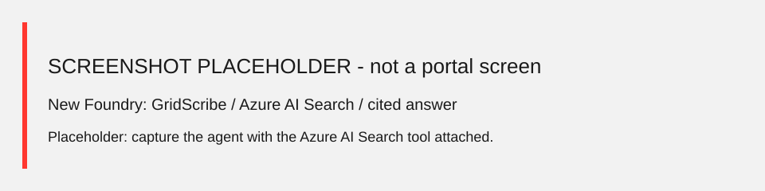

[Home](../README.md) › Step 6

# Step 6 — Connect and ask GridScribe

**About 2 minutes target; share the final 5-minute stage with Step 7.** Primary route: **new Foundry prompt agent + Azure AI Search tool**, directly targeting the existing index. Do not use a raw ungrounded Chat playground and assume it is RAG.

## 1. Connect the Search service to your project (1 minute)

1. At [ai.azure.com](https://ai.azure.com), keep **New Foundry** on and open project `gridscribe-<initials>`.
2. Select **Manage** › **Project details** › **Connected resources** tab › **Add connection** › **Azure AI Search**.
3. Browse for and select `srch-gridscribe-<initials>-<4 digits>`. Authentication **API key** (the portal fills it in for you). Name the connection **`gridscribe-search`** if asked, then select **Add connection**.

**Expected result:** `gridscribe-search` appears under **Connected resources**.

**If it fails:** service not listed → check you are in the same subscription and directory as in Azure portal; key not filled in → copy the **Primary admin key** from Search › **Settings** › **Keys** into the key box (never anywhere else).

After the workshop: keyless instead of keys

Set Search › **Settings** › **Keys** to **Both**, then give the **Foundry resource's system-assigned identity** the **Search Index Data Contributor** and **Search Service Contributor** roles on the Search service, and choose the managed-identity authentication option when you add the connection.

## 2. Create GridScribe and give it the library

1. In the left pane select **Build** › **Agents** › **Create agent**. Name it **GridScribe** (use `gridscribe` if only lowercase is accepted) and select **Create**.
2. In the agent builder, set **Model** to your **`gridscribe-chat`** deployment.
3. Open [prompts/gridscribe-instructions.md](../prompts/gridscribe-instructions.md), copy everything below the title, and paste it into **Instructions**.
4. Under **Tools**, select **Add** › **Azure AI Search**. Choose:
   - connection **`gridscribe-search`**;
   - index **`gridscribe-index`**;
   - search type **Hybrid (vector + keyword)** — this is `vector_simple_hybrid`; do not pick a "semantic" option, because we left semantic ranker off;
   - top results **5**.

   Select **Connect** (or **Add**). Add no other tools: no web search, no file search, no code interpreter.
5. Select **Save**.

The tool reads each chunk's `chunk` text and builds citations from its `title` (the file name) and `url` fields, which you created in Step 5.

> [!NOTE]
> TODO (facilitator): verify in dry run — the exact button labels in step 4 on the workshop date (the Learn page documents the tool and its settings rather than each button). If the label for hybrid search differs, update this page and slide 11.

**Expected result:** GridScribe shows the `gridscribe-chat` model, your instructions and one tool, **Azure AI Search** › `gridscribe-index`.

**If it fails:** `gridscribe-search` not listed → finish part 1 first and refresh; index not listed → check the index name in Azure portal is exactly `gridscribe-index`; model not listed → the deployment is still creating or failed (see [Step 4](04-foundry-and-models.md)).
## 3. Ask a small question first

In the agent playground, start a fresh conversation:

> What is the minimum spacing between BESS containers? Check the current edition and any amendment. Cite document, edition and clause.

Open the citations and compare with the source files. A citation marker alone is not enough: it must support the number and edition in the sentence. Then continue to [testing](07-test-and-evaluate.md).

**Expected result:** an answer marked **DRAFT**, a current-edition requirement and a citation that resolves to retrieved library content. The agent's tool activity should show a Search call, not just a model response.

**If it fails:** no citations → confirm the Search tool is attached, select ordinary hybrid mode, inspect retrieval and start a fresh conversation after instruction changes. Missing menu → check New Foundry is on, then use [troubleshooting](troubleshooting.md); do not improvise a second architecture under the clock.

Sources checked 13 November 2026: [new Azure AI Search tool, connection steps and parameters](https://learn.microsoft.com/azure/foundry/agents/how-to/tools/ai-search), [portal agent creation](https://learn.microsoft.com/azure/foundry/quickstarts/get-started-code#create-an-agent), [tool/model compatibility](https://learn.microsoft.com/azure/foundry/agents/concepts/limits-quotas-regions).

---
[← Previous](05-index-the-library.md) · [Home](../README.md) · [Next →](07-test-and-evaluate.md)

WSP AI Accelerator · UoC Insight Day 2026
